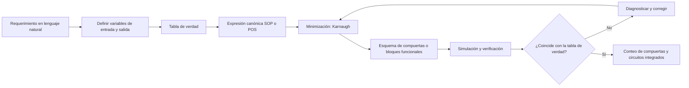

<div align="center">

# Cuaderno de Síntesis — Unidad 1
## Análisis de Lógica Combinacional con Diseño Clásico

**Asignatura:** Diseño de Circuitos · **Código:** E2C2A1  
**Universidad Nacional de Loja** · Facultad de la Energía, las Industrias y los Recursos Naturales No Renovables  
**Carrera:** Computación · **Ciclo:** 2 · **Paralelo:** A  
**Período académico:** septiembre 2026 – marzo 2027  
**Docente:** Luis Darío Sinche Cueva

**Estudiante:** [Nombre completo]  
**Archivo de entrega (PDF):** `U1_Cuaderno_Apellido_Nombre.pdf`

</div>

---

## Menú de navegación

| | | |
|---|---|---|
| [Semana 1 · Sistemas numéricos y compuertas](#semana-1) | [Semana 2 · Álgebra de Boole y formas canónicas](#semana-2) | [Semana 3 · Mapas de Karnaugh y NAND/NOR](#semana-3) |
| [Semana 4 · Circuitos aritméticos](#semana-4) | [Semana 5 · Selección y codificación de datos](#semana-5) | [Semana 6 · Consolidación](#semana-6) |
| [Resumen del procedimiento de diseño](#procedimiento) | [Registro de dudas pendientes](#dudas) | [Declaración de uso de IA y referencias](#referencias) |

---

## Resultado de aprendizaje de la unidad

> **R1.** Diseña e implementa circuitos combinacionales básicos utilizando técnicas de diseño clásico, bajo los principios de solidaridad, transparencia, responsabilidad y honestidad. [7]

Un **circuito combinacional** es aquel cuya salida depende **únicamente de la combinación de entradas presente** en ese instante. No tiene memoria.

## Mapa de la unidad

| Semana | Tema | Práctica asociada (APE) | Herramienta |
|:---:|---|---|---|
| 1 | Sistemas numéricos, códigos y compuertas lógicas | Guía 01 · Entorno de simulación y comprobación de compuertas | Simulador lógico, 74LS |
| 2 | Álgebra de Boole, De Morgan, minitérminos y maxitérminos | Guía 02 · Formas canónicas y simplificación algebraica | Simulador lógico |
| 3 | Mapas de Karnaugh, condiciones indiferentes, NAND/NOR | Guía 03 · Optimización de hardware con Karnaugh | Simulador lógico |
| 4 | Semisumador, sumador completo, paralelo, resta y comparador | Guía 04 · Circuitos sumadores | Simulador lógico |
| 5 | Mux, demux, codificador, decodificador, display 7 segmentos | Guía 05 · Encaminamiento y visualización de datos | Simulador lógico |
| 6 | Consolidación, evaluación sumativa y primer avance del proyecto | Primer avance del proyecto integrador | Laboratorio |

## Estructura sugerida del repositorio

```text
cuaderno-diseno-circuitos-u1/
├── README.md                  # Este cuaderno
├── MENU.md                    # Menú de acceso rápido
├── semana-01/                 # Archivos .circ, capturas y notas
├── semana-02/
├── semana-03/
├── semana-04/
├── semana-05/
├── semana-06/
└── recursos/                  # Hojas de datos 74LS, imágenes, apuntes escaneados
```

---

<a id="semana-1"></a>
# Semana 1 · Sistemas numéricos, códigos y compuertas lógicas

**Idea central:** un computador representa toda la información con **dos estados eléctricos** (nivel bajo = 0, nivel alto = 1). Todo lo demás (números, texto, imágenes) es una convención sobre cadenas de bits. [1][2]

## 1.1 Sistemas de numeración

| Sistema | Base | Símbolos | Uso típico |
|---|:---:|---|---|
| Binario | 2 | 0, 1 | Representación interna |
| Octal | 8 | 0–7 | Agrupa 3 bits |
| Decimal | 10 | 0–9 | Uso humano |
| Hexadecimal | 16 | 0–9, A–F | Agrupa 4 bits |

**Conversiones**

- **Decimal → binario:** divisiones sucesivas entre 2; se leen los residuos de abajo hacia arriba.
- **Binario → decimal:** suma de potencias de 2 (valor posicional).
- **Binario ↔ octal / hexadecimal:** se agrupan los bits de 3 en 3 (octal) o de 4 en 4 (hexadecimal), desde la derecha.

**Ejemplo resuelto:** convertir 45₁₀.

```text
45 = 32 + 8 + 4 + 1  →  101101₂
Octal:        101 101      →  55₈
Hexadecimal:  0010 1101    →  2D₁₆
```

## 1.2 Aritmética binaria y complemento a dos

**Suma binaria:** 0+0=0 · 0+1=1 · 1+0=1 · 1+1=0 con acarreo 1.

**Complemento a dos (n bits):** permite representar enteros con signo.

1. Escribir el valor positivo en n bits.
2. Invertir todos los bits (complemento a uno).
3. Sumar 1.

**Ejemplo:** −5 en 4 bits → `0101` → `1010` → `1010 + 1 = 1011`.

Rango con n bits: de −2ⁿ⁻¹ a 2ⁿ⁻¹ − 1 (en 4 bits: de −8 a +7).

## 1.3 Códigos

| Código | Descripción | Ejemplo |
|---|---|---|
| **BCD** | Cada dígito decimal se codifica con 4 bits (solo 0000–1001) | 47₁₀ = `0100 0111` |
| **Gray** | Entre dos valores consecutivos cambia **un solo bit** | 000, 001, 011, 010, 110, 111, 101, 100 |
| **ASCII** | Código de 7 bits para caracteres | 'A' = 65₁₀ = `1000001` = 41₁₆ |

> El código Gray es la base del orden de filas y columnas en los mapas de Karnaugh (semana 3).

## 1.4 Compuertas lógicas

| Compuerta | Expresión | Salida = 1 cuando… |
|---|---|---|
| NOT | `A'` | la entrada es 0 |
| AND | `A·B` | **todas** las entradas son 1 |
| OR | `A+B` | **al menos una** entrada es 1 |
| NAND | `(A·B)'` | no todas las entradas son 1 |
| NOR | `(A+B)'` | todas las entradas son 0 |
| XOR | `A⊕B` | las entradas son **distintas** |
| XNOR | `(A⊕B)'` | las entradas son **iguales** |

**Tabla de verdad de dos entradas**

| A | B | AND | OR | NAND | NOR | XOR | XNOR |
|:-:|:-:|:---:|:--:|:----:|:---:|:---:|:----:|
| 0 | 0 | 0 | 0 | 1 | 1 | 0 | 1 |
| 0 | 1 | 0 | 1 | 1 | 0 | 1 | 0 |
| 1 | 0 | 0 | 1 | 1 | 0 | 1 | 0 |
| 1 | 1 | 1 | 1 | 0 | 0 | 0 | 1 |

## 1.5 Circuitos integrados de la familia 74LS

| Integrado | Contenido (4 o 6 compuertas por chip) |
|---|---|
| 74LS00 | 4 NAND de 2 entradas |
| 74LS02 | 4 NOR de 2 entradas (la distribución de pines difiere de la de 00, 08 y 32) |
| 74LS04 | 6 inversores (NOT) |
| 74LS08 | 4 AND de 2 entradas |
| 74LS32 | 4 OR de 2 entradas |
| 74LS86 | 4 XOR de 2 entradas |

En la mayoría de estos chips de 14 pines, **pin 14 = Vcc (+5 V)** y **pin 7 = GND**. Siempre se confirma en la hoja de datos antes de conectar.

## 1.6 Práctica asociada

**Guía APE 01 — Reconocimiento del entorno de simulación lógica y comprobación de compuertas.** Se coloca fuente, interruptores y sondas lógicas, y se comprueba experimentalmente la tabla de verdad de cada compuerta.

**Qué debo recordar de la semana**
- Todo se reduce a 0 y 1; las bases octal y hexadecimal solo abrevian el binario.
- El complemento a dos unifica suma y resta.
- Cada compuerta se define por su tabla de verdad; el 74LS es su versión física.

---

<a id="semana-2"></a>
# Semana 2 · Álgebra de Boole y formas canónicas

**Idea central:** un circuito y una expresión booleana son **la misma cosa escrita de dos maneras**. Esto permite manipular el circuito con matemáticas. [1][2]

## 2.1 Postulados y teoremas

| Propiedad | Forma AND | Forma OR |
|---|---|---|
| Identidad | `A·1 = A` | `A+0 = A` |
| Elemento nulo | `A·0 = 0` | `A+1 = 1` |
| Idempotencia | `A·A = A` | `A+A = A` |
| Complemento | `A·A' = 0` | `A+A' = 1` |
| Involución | `(A')' = A` | |
| Conmutativa | `A·B = B·A` | `A+B = B+A` |
| Asociativa | `(A·B)·C = A·(B·C)` | `(A+B)+C = A+(B+C)` |
| Distributiva | `A·(B+C) = A·B + A·C` | `A+B·C = (A+B)·(A+C)` |
| Absorción | `A·(A+B) = A` | `A+A·B = A` |
| Simplificación | `A·(A'+B) = A·B` | `A+A'·B = A+B` |

## 2.2 Leyes de De Morgan

```text
(A·B)' = A' + B'        La negación de un AND es el OR de las negaciones
(A+B)' = A' · B'        La negación de un OR es el AND de las negaciones
```

Sirven para convertir entre AND/OR y NAND/NOR (ver semana 3).

## 2.3 Minitérminos y maxitérminos

Para n variables hay 2ⁿ combinaciones. Cada fila de la tabla de verdad tiene un índice decimal.

- **Minitérmino mᵢ:** producto (AND) de **todas** las variables, que vale 1 **solo** en la fila i. Variable en 1 → directa; en 0 → complementada.
- **Maxitérmino Mᵢ:** suma (OR) de **todas** las variables, que vale 0 **solo** en la fila i. Variable en 0 → directa; en 1 → complementada.
- Relación: `mᵢ' = Mᵢ`.

| Fila | A B C | Minitérmino | Maxitérmino |
|:---:|:---:|---|---|
| 0 | 0 0 0 | `A'B'C'` | `A+B+C` |
| 1 | 0 0 1 | `A'B'C` | `A+B+C'` |
| 2 | 0 1 0 | `A'BC'` | `A+B'+C` |
| 3 | 0 1 1 | `A'BC` | `A+B'+C'` |
| 4 | 1 0 0 | `AB'C'` | `A'+B+C` |
| 5 | 1 0 1 | `AB'C` | `A'+B+C'` |
| 6 | 1 1 0 | `ABC'` | `A'+B'+C` |
| 7 | 1 1 1 | `ABC` | `A'+B'+C'` |

## 2.4 Formas canónicas

- **Suma de productos (SOP):** OR de los minitérminos de las filas donde F = 1. Notación: `F = Σm(…)`.
- **Producto de sumas (POS):** AND de los maxitérminos de las filas donde F = 0. Notación: `F = ΠM(…)`.

**Criterio de elección:** si hay **menos unos que ceros**, conviene SOP; si hay **menos ceros que unos**, conviene POS.

## 2.5 Ejemplo resuelto: sistema de alarma de tres sensores

**Requerimiento:** la alarma debe sonar cuando **al menos dos** de los tres sensores (A, B, C) estén activos.

| A | B | C | F |
|:-:|:-:|:-:|:-:|
| 0 | 0 | 0 | 0 |
| 0 | 0 | 1 | 0 |
| 0 | 1 | 0 | 0 |
| 0 | 1 | 1 | **1** |
| 1 | 0 | 0 | 0 |
| 1 | 0 | 1 | **1** |
| 1 | 1 | 0 | **1** |
| 1 | 1 | 1 | **1** |

**SOP canónica:** `F = Σm(3,5,6,7) = A'BC + AB'C + ABC' + ABC`

**POS canónica:** `F = ΠM(0,1,2,4) = (A+B+C)(A+B+C')(A+B'+C)(A'+B+C)`

**Simplificación algebraica:**

```text
F = A'BC + AB'C + ABC' + ABC
  = A'BC + AB'C + ABC' + ABC + ABC + ABC     (idempotencia: se repite ABC dos veces)
  = (A'BC + ABC) + (AB'C + ABC) + (ABC' + ABC)
  = BC(A'+A) + AC(B'+B) + AB(C'+C)
  = BC + AC + AB
```

**Comparación de costo**

| Versión | Compuertas |
|---|---|
| Canónica SOP | 3 NOT + 4 AND de 3 entradas + 1 OR de 4 entradas |
| Simplificada | 3 AND de 2 entradas + 1 OR de 3 entradas |

La simplificada cumple **la misma tabla de verdad** con menos compuertas y menos circuitos integrados.

## 2.6 Práctica asociada

**Guía APE 02 — Formas canónicas y simplificación algebraica.** Del requerimiento a la tabla de verdad, extracción de minitérminos, montaje del circuito canónico y del simplificado, y recuento comparativo de compuertas y circuitos integrados.

**Qué debo recordar de la semana**
- Un requerimiento en lenguaje natural debe traducirse a tabla de verdad sin ambigüedad.
- SOP lee los unos; POS lee los ceros.
- La simplificación algebraica funciona, pero **no indica cuándo se llegó al mínimo** (esto motiva la semana 3).

---

<a id="semana-3"></a>
# Semana 3 · Mapas de Karnaugh, condiciones indiferentes y universalidad NAND/NOR

**Idea central:** disponer la tabla de verdad en una cuadrícula con orden Gray hace **visible** la simplificación. [1][2]

## 3.1 Construcción del mapa

- **3 variables:** 8 celdas. **4 variables:** 16 celdas.
- Filas y columnas en **orden Gray** (00, 01, 11, 10), de modo que celdas vecinas difieren en un solo bit.
- El mapa es **cíclico**: los bordes opuestos son adyacentes (la columna izquierda toca a la derecha; la fila superior toca a la inferior).

**Mapa de 3 variables** (filas A, columnas BC):

| A \ BC | 00 | 01 | 11 | 10 |
|:---:|:---:|:---:|:---:|:---:|
| **0** | m0 | m1 | m3 | m2 |
| **1** | m4 | m5 | m7 | m6 |

**Mapa de 4 variables** (filas AB, columnas CD):

| AB \ CD | 00 | 01 | 11 | 10 |
|:---:|:---:|:---:|:---:|:---:|
| **00** | m0 | m1 | m3 | m2 |
| **01** | m4 | m5 | m7 | m6 |
| **11** | m12 | m13 | m15 | m14 |
| **10** | m8 | m9 | m11 | m10 |

## 3.2 Reglas de agrupación

1. Agrupar **unos** adyacentes en rectángulos de tamaño **potencia de 2** (1, 2, 4, 8, 16).
2. Cada grupo debe ser **lo más grande posible**.
3. Los grupos **pueden solaparse**.
4. Se cubren **todos** los unos con el **menor número de grupos**.
5. En cada grupo se conservan las variables que **no cambian**; las que cambian se eliminan.

- **Suma de productos mínima:** se agrupan los **unos**.
- **Producto de sumas mínimo:** se agrupan los **ceros** y se escribe cada grupo como suma (variable en 0 → directa; en 1 → complementada).

## 3.3 Condiciones indiferentes (don't care)

Son combinaciones que **nunca ocurren** o cuya salida **no importa**. Se marcan con **X**. Pueden tomarse como 1 si ayudan a formar grupos mayores, y se ignoran si no ayudan.

## 3.4 Ejemplo resuelto: función de 4 variables con indiferentes

**Función:** `F(A,B,C,D) = Σm(0,2,5,7,8,10) + d(13,15)`

| AB \ CD | 00 | 01 | 11 | 10 |
|:---:|:---:|:---:|:---:|:---:|
| **00** | 1 | 0 | 0 | 1 |
| **01** | 0 | 1 | 1 | 0 |
| **11** | 0 | X | X | 0 |
| **10** | 1 | 0 | 0 | 1 |

- **Grupo 1 (esquinas):** m0, m2, m8, m10 → `B'D'`
- **Grupo 2:** m5, m7 y las indiferentes m13, m15 → `BD`

```text
F = B'D' + BD        (equivale a XNOR de B y D)
```

Sin usar las indiferentes, los unos 5 y 7 solo formarían un grupo de 2 (`A'BD`), con un término más costoso.

## 3.5 Universalidad de NAND y NOR

Cualquier función puede construirse **solo con NAND** o **solo con NOR**.

**Con NAND:**

| Función | Construcción |
|---|---|
| NOT | `A' = NAND(A, A)` |
| AND | `A·B = NAND(NAND(A,B), NAND(A,B))` |
| OR | `A+B = NAND(A', B') = NAND(NAND(A,A), NAND(B,B))` |

**Con NOR (dual):** `A' = NOR(A,A)`, `A+B = NOR(NOR(A,B), NOR(A,B))`, `A·B = NOR(A', B')`.

**Procedimiento de conversión de un esquema SOP a NAND:** se reemplaza cada AND y el OR final por NAND (la doble negación se cancela por De Morgan).

**Aplicación al ejemplo anterior:**

```text
F = B'D' + BD = NAND( NAND(B',D'), NAND(B,D) )
B' = NAND(B,B)     D' = NAND(D,D)
Total: 2 inversores + 3 NAND = 5 compuertas NAND → 2 circuitos 74LS00 (4 compuertas por chip)
```

## 3.6 Práctica asociada

**Guía APE 03 — Optimización de hardware mediante mapas de Karnaugh.** Simulación del circuito antes y después de minimizar, comprobación de igualdad de tablas de verdad, conversión a una sola familia de compuertas y cuantificación del ahorro en compuertas y circuitos integrados.

**Qué debo recordar de la semana**
- Karnaugh garantiza saber cuándo se llegó al mínimo, a diferencia del método algebraico.
- Grupos grandes = menos variables = menos hardware.
- Las indiferentes se usan **solo si reducen** el costo.
- Con una sola familia (NAND o NOR) se reduce la variedad de circuitos integrados necesarios.

---

<a id="semana-4"></a>
# Semana 4 · Bloques combinacionales aritméticos

**Idea central:** un circuito **sin memoria** puede sumar, y el **acarreo** es el problema central de todo sumador. Estos bloques son la base de la unidad aritmético-lógica (ALU) de un procesador. [1][2]

## 4.1 Semisumador (Half Adder)

Suma **dos bits**, sin acarreo de entrada.

| A | B | S (suma) | C (acarreo) |
|:-:|:-:|:-:|:-:|
| 0 | 0 | 0 | 0 |
| 0 | 1 | 1 | 0 |
| 1 | 0 | 1 | 0 |
| 1 | 1 | 0 | 1 |

```text
S = A ⊕ B        C = A · B
```

## 4.2 Sumador completo (Full Adder)

Suma **tres bits**: A, B y el acarreo de entrada Cin.

| A | B | Cin | S | Cout |
|:-:|:-:|:-:|:-:|:-:|
| 0 | 0 | 0 | 0 | 0 |
| 0 | 0 | 1 | 1 | 0 |
| 0 | 1 | 0 | 1 | 0 |
| 0 | 1 | 1 | 0 | 1 |
| 1 | 0 | 0 | 1 | 0 |
| 1 | 0 | 1 | 0 | 1 |
| 1 | 1 | 0 | 0 | 1 |
| 1 | 1 | 1 | 1 | 1 |

```text
S    = A ⊕ B ⊕ Cin
Cout = A·B + Cin·(A ⊕ B)
```

**Construcción:** dos semisumadores y una compuerta OR.

```text
HA1: S1 = A ⊕ B,        C1 = A·B
HA2: S  = S1 ⊕ Cin,     C2 = S1·Cin
Cout = C1 + C2
```

## 4.3 Sumador paralelo de 4 bits (propagación de acarreo)

Se encadenan 4 sumadores completos: el `Cout` de cada etapa alimenta el `Cin` de la siguiente.

```text
 A3 B3     A2 B2     A1 B1     A0 B0
  │  │      │  │      │  │      │  │
 [FA3]◄────[FA2]◄────[FA1]◄────[FA0]◄── Cin = 0
  │  │      │  │      │  │      │
 C4 S3     S2        S1        S0
```

**Ejemplo:** `0101 (5) + 0011 (3) = 1000 (8)`.

**Retardo de propagación:** el acarreo "viaja" de etapa en etapa, por lo que el retardo total crece **linealmente con el número de bits** (≈ n × retardo del acarreo por etapa). La suma correcta solo es válida cuando el acarreo del último bit se ha estabilizado. Existen sumadores con acarreo anticipado que reducen este retardo a cambio de más compuertas.

## 4.4 Resta por complemento a dos

`A − B = A + (B' + 1)`

Con un sumador paralelo: se pasa B por compuertas **XOR** controladas por una línea M (M = 0 suma, M = 1 resta) y se usa `Cin = M`.

**Ejemplo:** 7 − 3 en 4 bits.

```text
 3 = 0011  →  complemento a dos = 1101
 0111 + 1101 = 1 0100  →  se descarta el acarreo final  →  0100 = 4 ✔
```

**Desbordamiento (overflow):** ocurre cuando el resultado excede el rango representable; en complemento a dos se detecta cuando los acarreos hacia y desde el bit de signo son distintos.

## 4.5 Comparador de magnitud

Compara dos números A y B y produce tres salidas: `A>B`, `A=B`, `A<B`.

**Comparador de 1 bit:**

```text
A>B = A·B'        A=B = (A ⊕ B)'        A<B = A'·B
```

Para más bits se compara desde el bit más significativo; si son iguales, se pasa al siguiente.

## 4.6 Relación con el procesador

Sumador + restador + comparador son los bloques esenciales de la **ALU**, donde se ejecutan las instrucciones aritméticas.

## 4.7 Práctica asociada

**Guía APE 04 — Implementación de circuitos sumadores.** Construcción simulada de semisumador y sumador completo con compuertas, interconexión en un sumador paralelo de 4 bits, comprobación sobre indicadores de salida y verificación de la resta por complemento a dos.

**Qué debo recordar de la semana**
- El sumador completo se obtiene con el **mismo procedimiento de diseño** (tabla de verdad → expresión → circuito).
- El acarreo limita la velocidad; su propagación define el retardo.
- Restar es sumar el complemento a dos.

---

<a id="semana-5"></a>
# Semana 5 · Selección y codificación de datos

**Idea central:** un sistema digital debe **encaminar** datos entre varias fuentes y destinos, y **convertir** entre representaciones de la misma información. [1][2]

## 5.1 Multiplexor (MUX)

Selecciona **una de 2ⁿ entradas** y la envía a **una sola salida**, según n líneas de selección.

```text
MUX 2:1:   Y = S'·I0 + S·I1
MUX 4:1:   Y = S1'S0'·I0 + S1'S0·I1 + S1S0'·I2 + S1S0·I3
```

## 5.2 Demultiplexor (DEMUX)

Operación **dual** al MUX: recibe **una entrada** y la dirige a **una de 2ⁿ salidas**, según las líneas de selección.

## 5.3 Decodificador

Activa **una sola** de 2ⁿ salidas según el código de n bits de entrada. Cada salida es un **minitérmino**.

**Decodificador 2:4:**

| A1 | A0 | Y0 | Y1 | Y2 | Y3 |
|:-:|:-:|:-:|:-:|:-:|:-:|
| 0 | 0 | 1 | 0 | 0 | 0 |
| 0 | 1 | 0 | 1 | 0 | 0 |
| 1 | 0 | 0 | 0 | 1 | 0 |
| 1 | 1 | 0 | 0 | 0 | 1 |

## 5.4 Codificador

Operación inversa: convierte la línea activa (de 2ⁿ entradas) en el **código binario de n bits**. El **codificador con prioridad** resuelve el caso de varias entradas activas simultáneamente, atendiendo a la de mayor prioridad.

## 5.5 Decodificador BCD a siete segmentos

Convierte un dígito BCD (4 bits) en las señales `a b c d e f g` que encienden los segmentos de un display.

| Dígito | Segmentos encendidos |
|:-:|---|
| 0 | a b c d e f |
| 1 | b c |
| 2 | a b d e g |
| 3 | a b c d g |
| 4 | b c f g |
| 5 | a c d f g |
| 6 | a c d e f g |
| 7 | a b c |
| 8 | a b c d e f g |
| 9 | a b c d f g |

> Se debe verificar si el display es de **ánodo común** o **cátodo común**, porque cambia el nivel lógico que enciende cada segmento. Las combinaciones BCD 1010–1111 son indiferentes o muestran símbolos especiales según el integrado.

## 5.6 Expansión de bloques

Dos MUX 4:1 más un MUX 2:1 forman un MUX 8:1. De igual modo se combinan decodificadores pequeños para obtener uno de más salidas, usando las entradas de habilitación (*enable*).

## 5.7 Implementación de funciones con multiplexor

Un MUX de 2ⁿ canales implementa **cualquier función de n variables** sin minimización previa: las variables van a las **líneas de selección** y cada entrada de datos se conecta a **0 o 1** según la tabla de verdad.

**Ejemplo resuelto:** `F(A,B,C) = Σm(1,2,4,7)` con un MUX 8:1 (selección A, B, C):

| Entrada | I0 | I1 | I2 | I3 | I4 | I5 | I6 | I7 |
|---|:-:|:-:|:-:|:-:|:-:|:-:|:-:|:-:|
| Valor | 0 | 1 | 1 | 0 | 1 | 0 | 0 | 1 |

(Esta función es la paridad impar: `F = A ⊕ B ⊕ C`.)

**Variante con MUX 4:1:** selección con A y B, y entradas de datos en función de C:

| AB | 00 | 01 | 10 | 11 |
|:-:|:-:|:-:|:-:|:-:|
| Entrada de datos | `C` | `C'` | `C'` | `C` |

## 5.8 Comparación: compuertas vs. multiplexor

| Criterio | Compuertas (con Karnaugh) | Multiplexor |
|---|---|---|
| Requiere minimizar | Sí | No |
| Cambio de función | Rediseñar el circuito | Cambiar las conexiones a 0/1 |
| Costo en compuertas | Suele ser menor en funciones simples | Fijo por tamaño del MUX |

## 5.9 Práctica asociada

**Guía APE 05 — Encaminamiento y visualización de datos.** Simulación de un MUX que selecciona entre cuatro fuentes, implementación de una función lógica con ese MUX y control de un display de siete segmentos con un decodificador BCD.

**Qué debo recordar de la semana**
- MUX y DEMUX son duales; codificador y decodificador son inversos.
- El decodificador entrega minitérminos; el MUX implementa una función directamente desde su tabla.
- Elegir entre compuertas y bloques funcionales es una decisión de diseño con criterio de costo.

---

<a id="semana-6"></a>
# Semana 6 · Consolidación y evaluación de la unidad

**Actividades de la semana:** repaso guiado de dificultades, evaluación sumativa teórico-práctica de la Unidad 1 (contenidos de las semanas 1 a 5), socialización de resultados y presentación del **primer avance del proyecto integrador de saberes**. [7]

<a id="procedimiento"></a>
## 6.1 Resumen del procedimiento de diseño combinacional



## 6.2 Cuadro comparativo de técnicas

| Técnica | Cuándo usarla | Ventaja | Limitación |
|---|---|---|---|
| Forma canónica | Primer paso, a partir de la tabla | Sistemática y directa | Mayor número de compuertas |
| Simplificación algebraica | Funciones pequeñas o expresiones ya dadas | No requiere dibujar mapas | No garantiza el mínimo |
| Karnaugh | Hasta 4 variables | Garantiza la expresión mínima | Poco práctico con más variables |
| NAND/NOR únicamente | Reducir variedad de integrados | Un solo tipo de chip | Esquema menos legible |
| Multiplexor | Funciones con tabla conocida | Sin minimización previa | Costo fijo del bloque |

## 6.3 Errores frecuentes a evitar

1. Olvidar que el mapa de Karnaugh **usa orden Gray**, no binario natural.
2. Hacer grupos de tamaño que **no es potencia de 2**.
3. No aprovechar el **cierre cíclico** del mapa (bordes opuestos).
4. Usar una condición indiferente que **no reduce** el costo.
5. Confundir **SOP con POS** al agrupar ceros (variables con polaridad invertida).
6. Dejar sin verificar el circuito: la simulación debe **contrastarse con la tabla de verdad**, y si discrepa, se explica y se corrige (nunca se oculta).
7. Ignorar el **acarreo final** o el desbordamiento en sumas y restas con signo.

## 6.4 Lista de verificación de un diseño

- [ ] Variables de entrada y salida definidas y nombradas.
- [ ] Tabla de verdad completa (2ⁿ filas).
- [ ] Expresión canónica obtenida.
- [ ] Expresión mínima con Karnaugh (o justificación del método elegido).
- [ ] Esquema con numeración de integrados y pines.
- [ ] Simulación que reproduce la tabla de verdad.
- [ ] Conteo de compuertas y circuitos integrados, antes y después de minimizar.

## 6.5 Aporte al proyecto integrador

La unidad entrega las técnicas para: especificar el sistema, levantar su **tabla de verdad**, obtener su **expresión mínima** y dejar simulado y verificado su **bloque combinacional**, que es el primero de los tres estados del mismo diseño (combinacional → secuencial → VHDL). [7]

---

<a id="dudas"></a>
# Registro de dudas pendientes

| N.º | Semana | Duda | Estado | Cómo se resolvió |
|:-:|:-:|---|:-:|---|
| 1 | | | Pendiente | |
| 2 | | | Pendiente | |
| 3 | | | Pendiente | |

---

<a id="referencias"></a>
# Declaración de uso de inteligencia artificial

> El sílabo exige declarar en cada entrega la herramienta, su finalidad y el procedimiento de verificación. [7]

| Herramienta | Finalidad | Procedimiento de verificación aplicado |
|---|---|---|
| [Herramienta] | [Ej.: estructurar el cuaderno y redactar resúmenes] | [Ej.: contraste con el texto base [1], comprobación de cada tabla de verdad y de cada ejemplo en el simulador] |

# Referencias (formato IEEE)

[1] J. D. Carpinelli, *An Animated Introduction to Digital Logic Design*. New Jersey: New Jersey Institute of Technology, 2023, ISBN 978-1-970194-005.

[2] G. Bégin, *Circuits logiques combinatoires et séquentiels*, 2023.

[3] Autodesk, "Tinkercad," 2023. [En línea]. Disponible en el recurso indicado en el sílabo.

[4] J. Á. Garza, *Electrónica digital I, Sistemas digitales*. Nuevo León, 2025.

[5] MuseMaze, Inc., "EveryCircuit," 2025.

[6] CircuitLab, "CircuitLab," 2025.

[7] L. D. Sinche Cueva, "Sílabo de la asignatura Diseño de Circuitos," Universidad Nacional de Loja, Facultad de la Energía, las Industrias y los Recursos Naturales No Renovables, Carrera de Computación, 2026.

---

<div align="center">

**Cuaderno de Síntesis · Unidad 1 · Diseño de Circuitos · UNL · 2026**  
[Volver al inicio](#cuaderno-de-síntesis--unidad-1)

</div>

